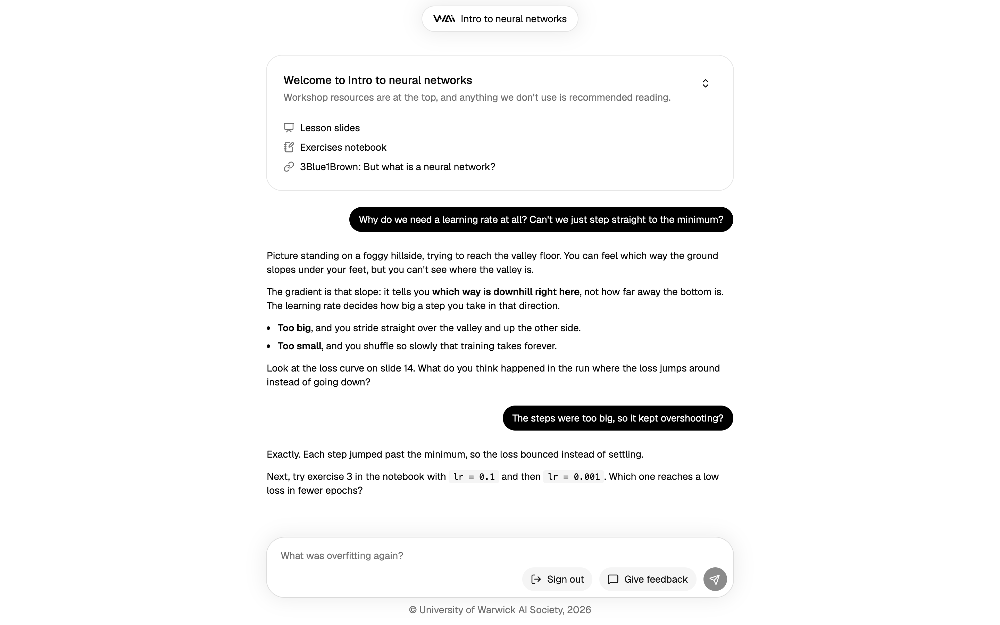
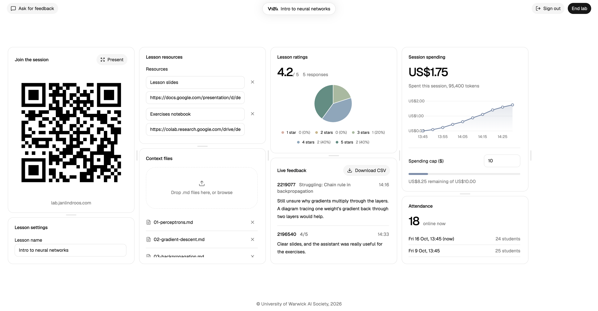

# Teaching assistant





## Deployment

Pushing to `main` deploys to Fly.io through GitHub Actions (`.github/workflows/deploy.yml`). Two Fly apps are involved, each with its own config: `teaching-assistant` (SvelteKit, `fly.toml`) and `teaching-assistant-api` (Go, `fly.api.toml`). The API app has only a private Flycast address, so nothing outside Fly's network can reach it. To deploy by hand:

```sh
fly deploy --config fly.api.toml
fly deploy
```

## Running costs

The web and API Machines stop themselves after a few idle minutes and start again on the next request, so they cost next to nothing between labs. The first page load after an idle period takes a couple of seconds. The database stays running; stop it after a lab and start it before the next one if you want to:

```sh
fly machine stop 82d10e6f054de8 -a teaching-assistant-db
fly machine start 82d10e6f054de8 -a teaching-assistant-db
```

The database keeps its data while stopped. If the ID changes, `fly machine list -a teaching-assistant-db` shows the current one.
